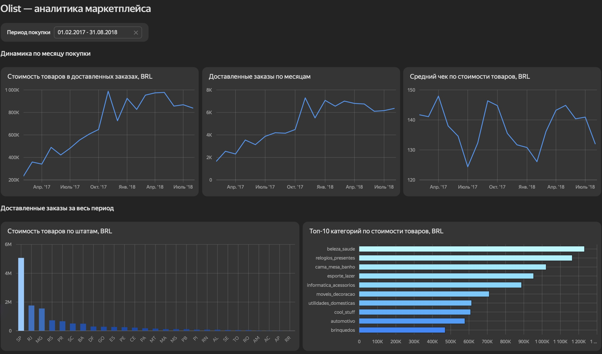
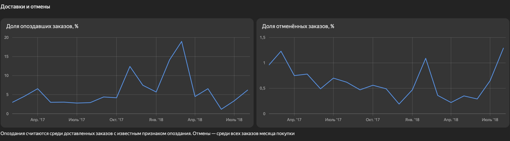
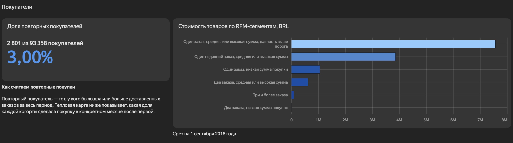
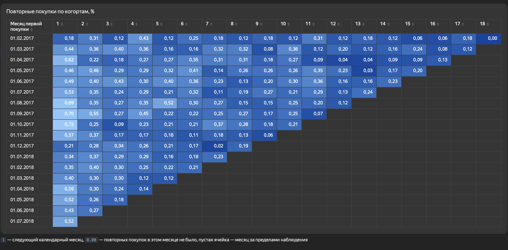

# Аналитика маркетплейса Olist

Исследовали продажи, доставку и повторные покупки на публичных данных бразильского маркетплейса Olist. Подготовили витрину в PostgreSQL, проверили динамику в Python и собрали интерактивный дашборд.

[Открыть дашборд в DataLens](https://datalens.yandex/kws13838njbi3?_share_link=public) · [Читать итоговый отчёт](docs/business-report.md) · [Скачать исходные данные](data/README.md)

## Что сделали в SQL

| Файл | Что сделали |
| --- | --- |
| [01_data_audit.sql](sql/01_data_audit.sql) | Проверили уникальность заказов, пропуски дат и связи между таблицами. Сверили стоимость товаров и доставки с платежами, учитывая, что у заказа может быть несколько позиций, платежей и отзывов. |
| [02_mart_orders.sql](sql/02_mart_orders.sql) | Собрали витрину `mart_orders` с одной строкой на заказ. Добавили данные о покупателях, стоимости товаров, платежах, отзывах и сроках доставки. |
| [03_business_metrics.sql](sql/03_business_metrics.sql) | Рассчитали число доставленных заказов, стоимость товаров, средний чек, продажи по штатам и категориям, доли повторных покупателей, отмен и опозданий. |
| [04_cohort_analysis.sql](sql/04_cohort_analysis.sql) | Сгруппировали покупателей по месяцу первой покупки и посчитали долю вернувшихся в каждый следующий месяц. |
| [05_rfm_analysis.sql](sql/05_rfm_analysis.sql) | Разбили покупателей на сегменты по давности, частоте и сумме покупок. Сравнили размеры сегментов и их вклад в стоимость товаров. |

## Почему DataLens

DataLens позволил загрузить подготовленные [CSV-выгрузки](scripts/export_data.py) без публикации локальной базы PostgreSQL. В одном дашборде разместили месячные графики с общим селектором, срезы за всю историю и когортную тепловую карту. Ссылкой можно поделиться вместе с отчётом.

## Что показывает дашборд

**Продажи росли за счёт числа заказов.** С февраля 2017 по август 2018 года число доставленных заказов выросло с 1 653 до 6 351, а стоимость товаров — с 234 тыс. до 839 тыс. BRL. Средний чек за это время снизился со 141,70 до 132,04 BRL. Срезы за всю историю показывают, что на Сан-Паулу пришлось 38,3% стоимости товаров.

**Пик опозданий пришёлся на март 2018 года.** Опоздали 18,96% доставленных заказов с известными датами. Максимум числа доставленных заказов был в ноябре 2017 года, когда доля опозданий составила 12,40%. Чтобы разобраться в мартовском всплеске, стоит сравнить сроки передачи перевозчику и доставки по регионам.

**Повторные покупки были редкими.** За всю историю 2 801 из 93 358 покупателей получили два заказа или больше (3,00%). В RFM-срезе сегмент с одним заказом и средней или высокой суммой дал 57,24% стоимости товаров. Отдельная группа покупателей с одной недавней покупкой подходит для теста предложения на второй заказ.

**Когорты показывают, когда покупатели возвращались.** В когортах с февраля 2017 по июль 2018 года 0,48% покупателей сделали заказ в следующем календарном месяце. Пустые ячейки обозначают месяцы за границей наблюдения.

